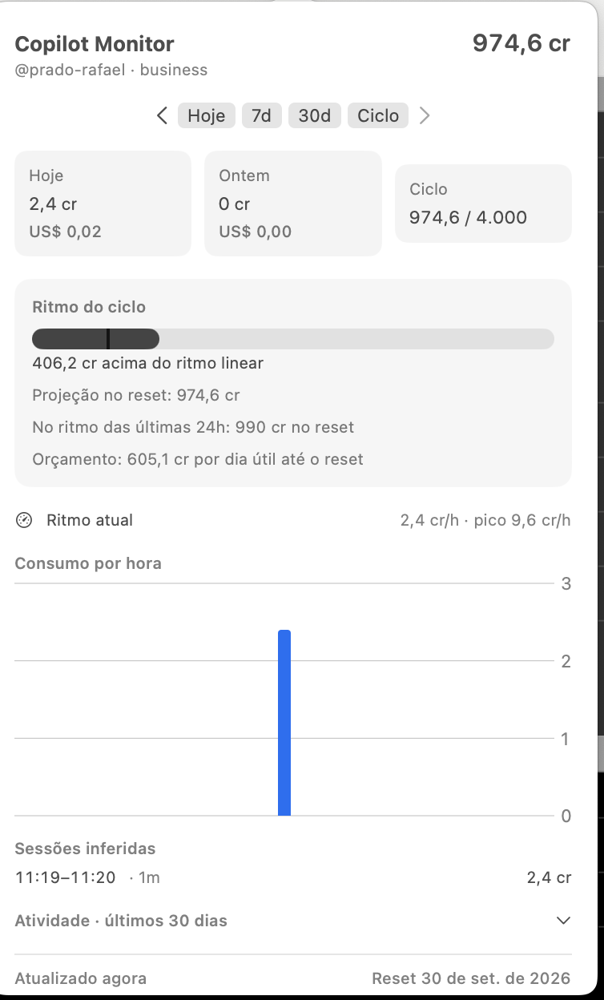

# Copilot Monitor


App de barra de menus para acompanhar os créditos de uso do Copilot pela API do GitHub. Os dados ficam em `~/Library/Application Support/CopilotMonitor/usage.sqlite`; nenhum log local do Copilot é lido.

## Recursos

- Estatísticas do período: média, pico e variação contra o período anterior, dias ativos, dia mais ativo, sessões e sequências de dias.
- Orçamento diário (automático pelos dias úteis até o reset, ou manual) com três estados: ok, atenção a partir de 80% e estourado.
- Sessão ativa no cabeçalho e no tooltip da barra.
- Comparação com o ciclo anterior no mesmo ponto; no início de um ciclo, a projeção usa o ciclo anterior como referência.
- Calendário de atividade das últimas 13 semanas e sparkline dos últimos 14 dias.
- Notificações de novo ciclo, mudança nos créditos do plano e correção confirmada do contador, além das de quota, projeção, orçamento e pico.
- Proteção contra leituras anômalas da API, com quarentena auditável e recuperação do histórico sem apagar amostras.

## Compilar

Requer macOS 14+, Swift 5.10 e Command Line Tools. Execute `./build.sh`; o app será criado em `build/CopilotMonitor.app`. O primeiro acesso usa `gh auth token` (com `gh` em `/opt/homebrew/bin` ou `/usr/local/bin`); um token alternativo pode ser salvo no Keychain nas Preferências.

## Linha de comando

O mesmo binário lê o histórico gravado pelo app e sai, sem abrir a interface nem acessar a rede:

- `--json`: relatório em JSON (ciclo, hoje com orçamento, ontem, ritmo, sessão ativa, sequência). Sempre sai com 0; em erro imprime `{"error": "..."}`.
- `--compact`: com `--json`, o JSON sai numa linha só.
- `--check`: orçamento diário e do ciclo com `OK`, `ATENÇÃO` ou `ESTOUROU`. Sai com 1 se algum estourou, 2 se não há dados e 0 caso contrário.
- `--help`: uso completo.

```sh
build/CopilotMonitor.app/Contents/MacOS/CopilotMonitor --json | jq .today
```

Para só lançar um agente se ainda houver orçamento:

```sh
#!/bin/sh
build/CopilotMonitor.app/Contents/MacOS/CopilotMonitor --check || exit 1
exec ./meu-agente.sh "$@"
```

## Leituras suspeitas da API

Uma queda do contador no mesmo ciclo não é mais interpretada como reset. O cálculo preserva a maior referência do ciclo: correções para baixo não geram consumo nem recontam créditos na recuperação; não há redistribuição retroativa do ajuste entre os dias.

Na coleta, um colapso contextual para `uso = 0` e `quota <= 1` depois de uma leitura com uso e quota maiores que 1 fica em quarentena, mesmo se repetir. Zero no início de um ciclo continua válido. Quedas maiores que 1 crédito e aumentos acima de `max(1.000 cr, 25% da quota anterior)` por janela de 10 minutos aguardam uma segunda resposta 200 coerente, com timestamps de coleta e da API pelo menos 60 s mais novos. A tolerância cresce proporcionalmente após ausências; não é um teto de consumo, e overage legítimo pode ser confirmado. Respostas 304 não confirmam anomalias.

Enquanto isso, a interface preserva os últimos valores válidos, mostra um aviso e não dispara alertas com a leitura suspeita. O JSON expõe `pendingReading` e marca `stale`; `--check` sai com 2 enquanto houver confirmação pendente. Um reinício preserva o aviso e exige novas respostas para confirmar.

Ao abrir um banco existente, os placeholders históricos são marcados na tabela `sample_quarantine`; `samples` não é apagada nem reescrita. As leituras rejeitadas na coleta também guardam nessa tabela o JSON original, timestamp da API e motivo. Payloads históricos que nunca foram salvos não podem ser recuperados. Gráficos, forecast, CLI e backfill de ciclos usam a mesma série filtrada.

Para auditar, com `sqlite3`:

```sql
SELECT q.sample_rowid, datetime(s.ts, 'unixepoch', 'localtime'),
       s.used, s.entitlement, q.reason, q.excluded
FROM sample_quarantine q JOIN samples s ON s.rowid = q.sample_rowid;
```

Uma exclusão pode ser revertida individualmente, sem apagar a evidência:

```sql
UPDATE sample_quarantine SET excluded = 0 WHERE sample_rowid = <id_revisado>;
```

Feche e reabra o app depois de uma revisão manual. A migração respeita essa decisão. Faça backup antes de editar o SQLite; os IDs de auditoria referenciam os `rowid` originais de `samples` (não recrie essa tabela nem renumere suas linhas).

## Teste e demonstração

`swift run CopilotMonitorSelfTest` executa os asserts da lógica pura. Para abrir a interface com dados sintéticos e sem chamadas de rede, execute:

```sh
COPILOT_MONITOR_DEMO=1 .build/debug/CopilotMonitor
```

O modo demo usa `usage-demo.sqlite`, sem alterar o banco normal. A linha de comando também respeita `COPILOT_MONITOR_DEMO=1`.
